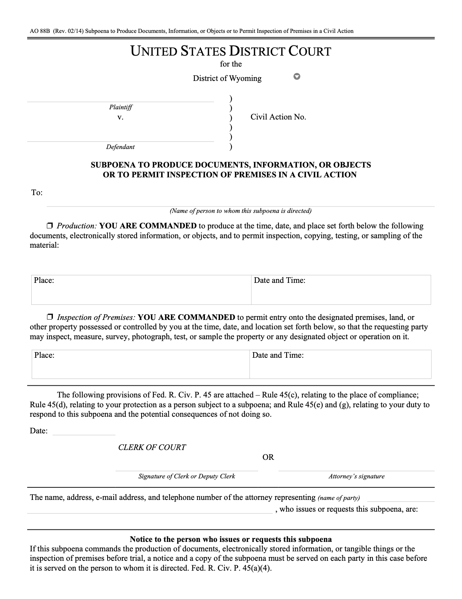
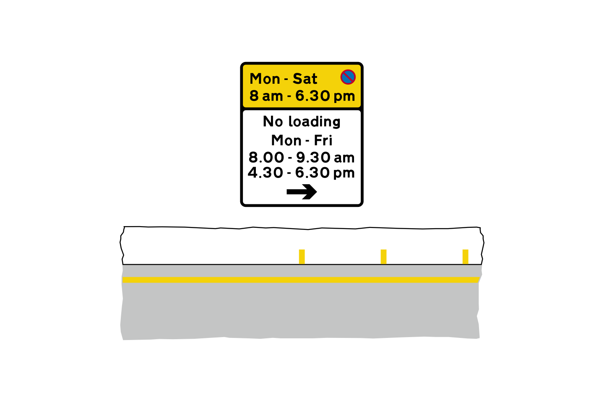
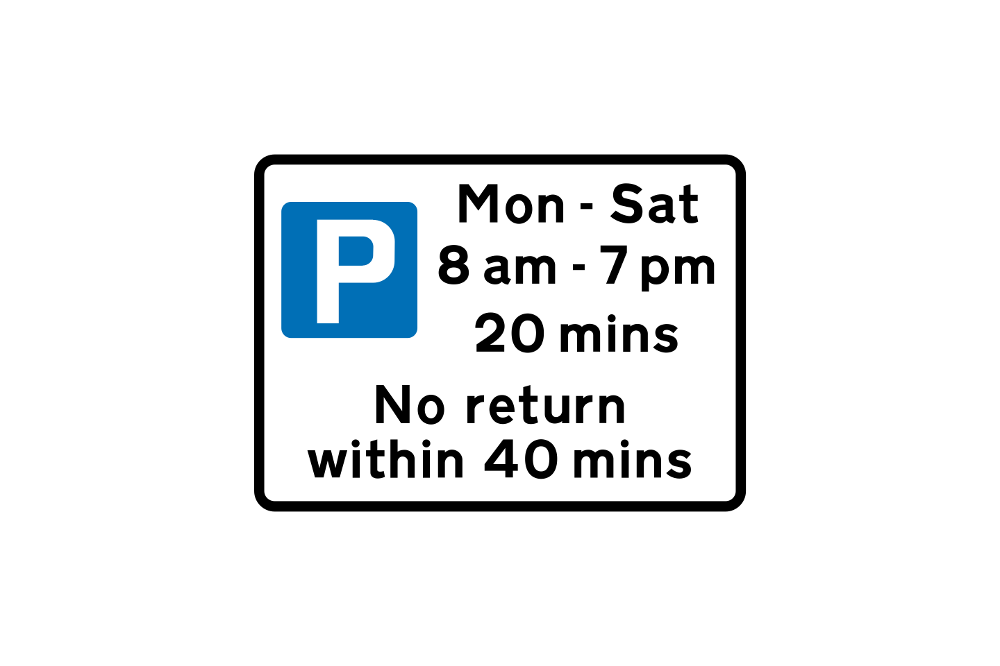

# Argumentação jurídica visual
## Preparação reprodutível de exemplos para notebooks

INE410159 • Trabalho de Visão Computacional

Preparado para revisão de Ana Vitória Vanzin Mendes e da colaboração com Guilherme. A identificação completa dos autores deverá ser confirmada na versão de submissão.

Versão de trabalho • 27 de outubro de 2026

### Resumo

Este relatório descreve uma solução de preparação e verificação local de exemplos visuais em contexto jurídico. O conjunto organiza seis tarefas derivadas de formulários judiciais e de sinalização de trânsito. Para cada tarefa, separam-se a imagem neutra, o contexto, o argumento incompleto, a regra operacional e o contrato de saída. A referência de avaliação guarda, em ambiente separado, as fontes, as regiões anotadas e as conclusões propostas.

O notebook prepara doze entradas: seis tarefas em duas condições, com e sem imagem. O texto é idêntico entre condições; somente o anexo visual é retirado. Três grupos de testes locais verificam integridade, separação de dados e preparação do notebook, incluindo recusas de pasta vazia e imagem com hash divergente.

Nenhuma inferência, treinamento ou avaliação de modelo foi realizada nesta continuação. As referências são propostas assistidas e aguardam revisão humana independente. O resultado entregue é um pacote de pesquisa reproduzível, acompanhado de notebook, verificações e documentação; não uma medição de desempenho jurídico.

### Estado da entrega

Relatório de 14 páginas e pôster em PDF. A versão de submissão ainda depende dos links da apresentação no Google Apresentações, do vídeo no YouTube e da publicação identificável do dataset de seis tarefas. O repositório de código indicado está referenciado, sem afirmar que esta cópia local já foi publicada.

Prazo informado pela usuária: terça-feira, 5 de janeiro de 2027, 04:24. O horário foi transcrito do enunciado e não constitui confirmação do relógio ou fuso da plataforma de entrega.

<!-- page -->
# 1. Problema, objetivos e recorte

A presença de uma palavra ou símbolo numa imagem não demonstra, por si só, o fato de interesse. Um formulário pode imprimir várias alternativas sem registrar qual delas foi selecionada. Uma seta pode pertencer a apenas um painel. Duas placas podem compartilhar a mesma letra e diferir no número de diagonais que a atravessam. Nessas situações, a relação entre elementos importa tanto quanto sua identificação isolada.

O problema do projeto é preparar situações nas quais se possa examinar se uma futura resposta distingue observação visual, informação fornecida no contexto e conclusão autorizada por uma regra. A aplicação jurídica é tratada por meio de exercícios controlados de leitura documental e aplicação de convenções explícitas. Não se pede decidir um processo ou atribuir responsabilidade a uma pessoa.

### Objetivos verificáveis desta versão

- Organizar seis tarefas com fontes identificadas e imagens preservadas por hash.
- Separar os estímulos permitidos ao candidato das referências exclusivas de avaliação.
- Preparar condições com e sem imagem sem modificar o texto do problema.
- Registrar abstenção quando a entrada não sustenta o fato visual necessário.
- Entregar um notebook de preparação local e uma verificação repetível do pacote.

### Relação com entendimento visual de documentos

FUNSD oferece uma referência para distinguir texto, posição e relações em formulários. DocVQA enquadra a resposta a perguntas sobre imagens documentais como tarefa que pode exigir a estrutura do documento. Aqui, a aproximação é metodológica: o conjunto usa um vocabulário formal restrito, regras fornecidas e controles sem imagem. Não reproduz os datasets, os protocolos ou a validação desses trabalhos [5–6].

A referência anterior de argumentação multimodal é mantida como antecedente técnico [7]. Seus resultados históricos, em outro domínio, não entram nos denominadores deste conjunto. Também não se afirma que as seis tarefas constituam uma amostra representativa de documentos jurídicos ou de sinais usados em vias reais.

<!-- page -->
# 2. Solução desenvolvida e organização

A solução é um pacote independente de preparação de dados. Ela reaproveita os quatro exemplos já materializados no aditivo anterior, completa duas propostas brasileiras e mantém os arquivos originais em sua localização de origem. As alterações desta continuação estão em uma cópia de trabalho separada.

### Fluxo efetivamente implementado

1. Localizar a fonte oficial e preservar o arquivo recebido.
2. Renderizar a página ou converter a ilustração; quando necessário, extrair um recorte neutro.
3. Conferir visualmente o estímulo e calcular seu SHA-256.
4. Registrar contexto, argumento incompleto, regra operacional e contrato em um JSON por tarefa.
5. Guardar fonte, interpretação proposta e regiões em referências separadas.
6. Carregar somente as entradas neutras no notebook e preparar duas condições por caso.
7. Conferir arquivos, hashes, correspondências e conteúdo do ZIP.

### Componentes e responsabilidades

| Componente | Conteúdo | Função |
| --- | --- | --- |
| model-input | Seis JSONs, seis imagens, índice e entradas JSONL | Estímulos permitidos ao candidato |
| evaluator-only | Quatro fontes originais, referências e histórico | Material reservado à avaliação |
| notebook-aditivo-offline.ipynb | Três células de código | Leitura local, hashes, preparação e prévia |
| verificar_pacote.py | Três grupos de testes | Verificação repetível do pacote |
| Manifesto e proveniência | Hashes e registro da cópia recebida | Rastreabilidade da entrega |

O notebook não importa o runner anterior, não cria um cliente de modelo, não instala dependências e não realiza download. A preparação em memória foi conferida localmente; as células do arquivo entregue permanecem sem saídas salvas, para que sua abertura não pareça uma execução experimental anterior.

O pacote também não altera a aplicação web existente. A eventual integração da interface, do runner e de um avaliador específico não está implementada nesta entrega. Essa separação evita apresentar compatibilidade de arquivos como se já houvesse um experimento completo.

<!-- page -->
# 3. Dataset preparado: composição e proveniência

O conjunto tem seis tarefas, seis imagens candidatas e quatro arquivos-fonte válidos. Há três famílias documentais: o formulário judicial AO88B, as duas ilustrações de um capítulo britânico e as duas placas extraídas do manual brasileiro de 2007. A seleção é pequena e intencional, orientada pela disponibilidade de evidência visual simples.

| Caso | Fonte e tarefa | Alvo da observação |
| --- | --- | --- |
| ADD01 | AO88B, página 1 | Estado de duas caixas de comando |
| ADD02 | Ilustração britânica | Associação da seta ao painel |
| ADD03 | Ilustração britânica | Dias, horários e limites distintos |
| ADD04 | Manual brasileiro, PDF p. 142 | Uma diagonal vermelha sobre E |
| ADD05 | Manual brasileiro, PDF p. 152 | Duas diagonais cruzadas sobre E |
| ADD06 | AO88B, página 2 | Estado das alternativas de cumprimento |

As duas páginas AO88B compartilham um PDF, e cada par de placas compartilha uma família. Portanto, seis tarefas não significam seis fontes independentes. Os exemplos não devem ser divididos aleatoriamente entre treino e teste como se a proximidade documental fosse irrelevante. Nesta versão, não há partição de treinamento nem ajuste de parâmetros.

### Proveniência e transformação

O formulário e os dois SVGs britânicos foram recebidos do pacote anterior e mantêm os hashes de seus originais. O manual brasileiro foi obtido por um endereço oficial alternativo do Ministério dos Transportes, após a origem municipal anterior ter retornado HTTP 488. Não se repetiu essa tentativa municipal.

Os recortes brasileiros têm o mesmo tamanho, 360 × 360 pixels, sem código ou título descritivo. As coordenadas de extração, a página-fonte e os hashes estão nas referências. A ampliação do raster não cria detalhe novo: a resolução limitada do documento continua sendo uma restrição dos estímulos.

As fontes estão listadas em [1–4]. A publicação de uma fonte na internet não é tomada como adjudicação de suas anotações, confirmação de uma ocorrência real ou autorização geral para todos os usos de suas imagens.

<!-- page -->
# 4. Formulário judicial: impresso e preenchido

ADD01 e ADD06 utilizam o formulário AO88B, revisão 02/14, hospedado pelo District of Wyoming [1]. O primeiro exemplo examina alternativas de produção de documentos e inspeção de instalações. O segundo examina alternativas de registro de cumprimento. Em ambos, o conteúdo impresso descreve possibilidades; a seleção depende do estado visível das caixas.



### ADD01: grupo de comando

A inspeção da imagem mostra as duas caixas-alvo vazias. Pela regra fornecida, a conclusão proposta é que não há escolha documental determinada entre essas alternativas. Isso não significa que nenhuma ordem tenha sido emitida no mundo. Também não permite inferir autenticidade, competência, validade ou cumprimento do documento.

### ADD06: registro de cumprimento

Na página 2, as alternativas served e unexecuted também aparecem sem marca. A conclusão operacional proposta é que o grupo examinado não determina uma opção de cumprimento registrada. A ausência de marca numa cópia de formulário não demonstra ocorrência nem não ocorrência do ato de citação ou intimação.

As regras tratam explicitamente marcas ilegíveis, conflito entre alternativas e seleção não inequívoca como razões para abster-se. Sem imagem, a resposta esperada pelo contrato é a abstenção sobre fatos visuais. O anexo histórico de Rule 45 incluído no PDF-fonte não é usado para declarar direito vigente.

As regiões e respostas esperadas são propostas de assistentes. A reconferência desta preparação não substitui revisão humana independente das alternativas e dos limites de inferência.

<!-- page -->
# 5. Placa britânica: relação espacial

ADD02 foi construído a partir de uma ilustração do Department for Transport [2]. Ela contém um painel superior amarelo e um painel inferior branco. A tarefa examina a posição de uma seta e sua associação ao comando de um painel específico, em lugar de tratar toda a imagem como um bloco sem estrutura.



A referência proposta identifica o comando de espera no painel superior e o comando de carga no inferior. A seta à direita aparece no painel inferior; não há seta no superior. A conclusão operacional é obtida aplicando a convenção fornecida: uma seta pertence apenas ao comando do painel que a contém, enquanto um painel sem seta recebe o âmbito definido pela regra do exercício.

### Por que o exemplo exige uma relação

Reconhecer a seta e reconhecer as palavras não basta. É necessário vincular a seta ao painel correto. A transferência da seta para o painel superior produziria uma premissa estrutural incorreta mesmo que todos os elementos visuais fossem individualmente reconhecidos.

A referência formal proposta conclui scope(doc1,both,right), na ordem dos âmbitos de espera e carga. Essa conclusão é uma aplicação da regra explicitamente fornecida. Não decide a validade de uma placa instalada, os limites físicos de uma via ou a ocorrência de uma infração.

A imagem pública pode já ser conhecida por um modelo. Nomes neutros e retirada das descrições da fonte reduzem pistas externas do pacote, mas não eliminam memória de treinamento. O controle sem imagem ajuda a investigar respostas sem evidência visual efetiva; ele não prova, isoladamente, a causa de uma resposta correta.

<!-- page -->
# 6. Placa britânica: leitura e comparação temporal

ADD03 utiliza outra ilustração do mesmo capítulo oficial [2]. O contexto estipula uma quarta-feira às 10h e uma permanência contínua de 25 minutos. Esses são fatos fictícios fornecidos; dias, horários e limites da placa devem ser obtidos dos pixels.



A referência proposta transcreve Mon–Sat, 8 am–7 pm, permanência máxima de 20 minutos e não retorno em 40 minutos. O cenário estipulado cai no período mostrado. Como 25 é maior que 20, a conclusão operacional proposta é exceeds_displayed_limit.

O intervalo de não retorno não é somado ao limite da permanência contínua. Ele se refere a outra situação, não presente no cenário estipulado. A leitura dessa inscrição é registrada como fato suplementar; não é premissa necessária para comparar a permanência contínua de 25 minutos com o limite de 20.

### Separação das fontes de informação

- Contexto: dia, hora e duração fictícios do cenário.
- Imagem: dias, horários e inscrições efetivamente exibidos.
- Regra: como comparar duração e período, sem inferir autorização jurídica geral.
- Conclusão: classificação operacional do cenário, condicionada às premissas.

Na continuação, foi retirado da regra um exemplo de conversão de horário que coincidia com a inscrição-alvo. A retirada reduz uma pista textual evitável, sem alterar a imagem ou o cenário. A conclusão permanece referência proposta; não é resposta observada de um modelo nem decisão sobre estacionamento real.

<!-- page -->
# 7. Par brasileiro: contraste visual mínimo

ADD04 e ADD05 foram completados nesta continuação com o Manual Brasileiro de Sinalização de Trânsito, Volume I, 2ª edição de 2007, obtido pelo Ministério dos Transportes [3–4]. O PDF tem 222 páginas; os sinais aparecem nas páginas PDF 142 e 152, correspondentes às páginas impressas 141 e 151.


Os dois estímulos mostram uma letra E, borda circular vermelha e diagonais vermelhas. O contraste é uma única diagonal em ADD04 e duas diagonais cruzadas em ADD05. Códigos oficiais, títulos e descrições foram excluídos dos recortes destinados ao candidato; permanecem na avaliação e na documentação.

A regra é fornecida como convenção hipotética: um padrão recebe a categoria operacional parking_prohibited e o outro stopping_and_parking_prohibited. A tarefa não exige recuperar uma norma de memória, e a edição histórica não é apresentada como declaração de direito vigente.

As imagens são recortes do documento, sem redesenho, síntese, realce ou texto sobreposto. A letra é parcialmente encoberta pelas diagonais, e o raster-fonte tem resolução modesta. As regiões anotadas e a própria leitura da letra continuam sujeitas a revisão humana.

O acesso à fonte foi resolvido, mas não foi identificada autorização específica para redistribuição pública dos recortes. Esta versão registra a atribuição e prepara os arquivos para estudo local; não atribui licença aberta ao manual. A questão de reutilização deve ser resolvida antes de publicar o pacote.

<!-- page -->
# 8. Contrato dos dados e da saída

Cada entrada neutra é um JSON com identificador, caminho e hash da imagem, contexto, argumento incompleto, regra fornecida, contrato e vocabulário. As referências ficam em arquivos separados. Os caminhos ativos de fonte e imagem nas referências são relativos à raiz do pacote, evitando convenções divergentes entre famílias.

| Campo de entrada | Significado |
| --- | --- |
| case_id / asset_id | Identificação neutra da tarefa e do estímulo |
| image / image_sha256 | Arquivo visual e identidade dos bytes |
| context | Fatos estipulados e delimitação do cenário |
| enthymeme | Pergunta ou argumento a completar |
| provided_rule | Regra operacional explicitamente fornecida |
| output_contract | Forma, alternativas autorizadas e abstenção |

A forma da saída é [premissas],conclusão. Cada átomo utiliza símbolos minúsculos e pertence ao vocabulário autorizado. Por exemplo, letter_e representa formalmente a letra E. O contrato inclui alternativas possíveis, sem selecionar antecipadamente qual delas ocorre na imagem.

### Exemplo de referência proposta, não resposta de modelo

```
[printed_letter(doc1,letter_e),
 red_diagonal_pattern(doc1,single_diagonal)],
operational_category(doc1,parking_prohibited)
```

Sem imagem, o contrato usa [],undetermined(visual_facts,doc1). Abstenção não transforma o fato desconhecido em falso. Um formato válido também não demonstra que a observação visual é verdadeira ou que a conclusão tem validade jurídica.

As caixas de referência usam XYXY normalizado, com origem no canto superior esquerdo do PNG candidato. O campo page identifica a página da fonte documental, e não uma exigência de que toda imagem pertença à página 1. Essa distinção é essencial para a segunda página do formulário e para os recortes do manual.

<!-- page -->
# 9. Condições preparadas e desenho de avaliação

Para cada tarefa, o notebook prepara uma condição com imagem e outra sem imagem, totalizando doze entradas. Não há repetição experimental executada. O campo repeat = 1 identifica apenas uma preparação por par caso–condição; não registra uma chamada de inferência.

| Elemento | with_image | without_image |
| --- | --- | --- |
| Contexto, argumento e regra | Idênticos | Idênticos |
| Contrato e vocabulário | Idênticos | Idênticos |
| Texto completo do prompt | Idêntico | Idêntico |
| Imagem e hash do anexo | Presentes | Ausentes |
| Resposta candidata nesta entrega | Não produzida | Não produzida |

Uma futura execução deve criar chamadas independentes. Se uma conversa já recebeu a imagem, pedir depois uma resposta sem anexo deixa o estímulo disponível no histórico. Essa situação não corresponde ao controle preparado aqui. O registro deverá preservar a entrada efetiva, o modelo e sua versão informada, a configuração, a resposta bruta e eventuais erros, sem corrigi-los silenciosamente.

### O que avaliar em etapa posterior

1. Conformidade sintática da resposta com o contrato.
2. Correspondência dos fatos com uma referência previamente revisada.
3. Associação da evidência às regiões pertinentes.
4. Adequação da abstenção quando a entrada não sustenta a conclusão.
5. Aplicação da regra somente às premissas efetivamente fornecidas ou observadas.

Não se calculam essas métricas a partir de entradas preparadas. Doze entradas não são doze acertos, e ausência de execução não equivale a acurácia zero. Também não se anuncia que este lote realiza as quatro ablações do pipeline histórico: a retirada isolada de contexto e de argumento incompleto não foi implementada nesta preparação.

<!-- page -->
# 10. Verificações realizadas e evidência disponível

O comando local python3 -B verificar_pacote.py executa três grupos de testes. A verificação foi refeita após a consolidação dos seis casos e compara os arquivos do pacote sem recorrer a rede, juiz de linguagem ou API de modelo.

| Grupo | Evidência conferida |
| --- | --- |
| Casos, imagens e referências | Seis IDs, PNGs, hashes, fontes, vocabulário, regiões e referência provisória |
| Condições e arquivo neutro | Doze entradas únicas, texto idêntico, controle sem anexo e ZIP comparado byte a byte |
| Preparação do notebook | Compilação das células, igualdade com JSONL e recusa de pasta vazia/hash divergente |

### Resultado local

Os três grupos de testes passaram. As duas primeiras células do notebook, que leem arquivos e montam registros em memória, foram exercitadas localmente. A célula de prévia foi conferida por compilação; a inspeção visual dos PNGs ocorreu separadamente. O arquivo do notebook permanece sem saídas salvas.

Os quatro exemplos herdados foram reconferidos por assistente, inclusive o estado das caixas e a associação entre painel, seta e inscrições. Os dois recortes brasileiros foram confrontados com suas páginas completas e com o contraste de diagonais observado. Essa reconferência não é adjudicação humana independente.

### O que esses resultados sustentam

Sustentam que a estrutura e os artefatos locais satisfazem os testes declarados. Não medem percepção visual de modelo, robustez a degradação, qualidade jurídica, generalização ou validade causal. Um hash identifica bytes; não demonstra autenticidade de um ato. Uma caixa normalizada localiza uma região proposta; não prova automaticamente a relação semântica associada.

Os registros OFFLINE-CHECKS.json, MANIFEST-SHA256.json e PROVENIENCIA-CONTINUACAO.json documentam a verificação, os arquivos e a cópia recebida. Artefatos vazios herdados de downloads antigos são mantidos como inválidos, separados das fontes efetivamente utilizadas.

<!-- page -->
# 11. Reprodução, compatibilidade e limites

A reprodução local começa com a pasta model-input ao lado do notebook. A leitura dos JSONs e o cálculo de hashes utilizam a biblioteca padrão do Python. A célula de prévia usa o ambiente de exibição do notebook. Nenhum download automático ou credencial de modelo integra o preparo entregue.

### Sequência para conferência

1. Extrair o pacote e preservar a separação entre entradas e avaliação.
2. Executar verificar_pacote.py e ler o resultado dos três grupos de testes.
3. Abrir o notebook e conferir as doze entradas preparadas em memória.
4. Revisar as referências em sessão de avaliação separada, sem fornecê-las a um candidato.
5. Resolver os requisitos de submissão e de publicação antes de eventual compartilhamento externo.

O aditivo não pode ser conectado diretamente ao avaliador anterior apenas trocando um arquivo. O adaptador histórico fixa outra tarefa e vocabulário; o avaliador espera chaves diferentes, outras condições e uma convenção de página 1. Em ADD03, exige-se ainda distinguir uma leitura suplementar das premissas necessárias à derivação. Nenhum desses componentes antigos foi alterado aqui.

### Limitações de pesquisa

O conjunto é pequeno, selecionado por conveniência documental e composto por famílias correlacionadas. Não sustenta estimativas populacionais de desempenho. As referências foram produzidas com exposição às fontes e podem conter vieses de seleção ou interpretação. A memória prévia de imagens públicas e o vocabulário restrito também afetam a leitura de futuros resultados.

Não há treinamento, ajuste fino ou checkpoint próprio produzido nesta continuação. Nenhuma versão de rede neural foi selecionada ou executada pelo notebook entregue. Isso limita o relatório à solução de dados e preparação, sem transformar um experimento planejado em experimento realizado.

O próximo avanço científico depende de revisão humana das referências, de protocolo de avaliação adequado às tarefas e de autorização para a etapa experimental. Uma eventual execução deverá ser relatada em versão nova, preservando esta preparação e suas respostas brutas futuras.

<!-- page -->
# 12. Artefatos, links e requisitos de submissão

O enunciado informado pede relatório simples de 10 a 20 páginas, mais detalhado que o pôster, com referências e links para dataset, código, apresentação no Google Apresentações e vídeo no YouTube. Também pede a inclusão do pôster em PDF. O prazo informado é 5 de janeiro de 2027, 04:24.

| Item exigido | Artefato ou endereço | Estado desta versão |
| --- | --- | --- |
| Relatório PDF | relatorio-argumentacao-juridica-visual.pdf | 14 páginas; versão de trabalho |
| Pôster PDF | poster-argumentacao-juridica-visual-A1.pdf | A1 vertical; versão de trabalho |
| Dataset de seis tarefas | somente-model-input.zip e pacote de pesquisa | Preparado localmente; URL permanente pendente |
| Código | Repositório indicado abaixo e notebook do pacote | Link existente; aditivo local não publicado |
| Checkpoint, caso exista | Nenhum produzido nesta continuação | Não se aplica à preparação sem treinamento |
| Google Apresentações | URL ainda não fornecida/localizada | Pendente |
| Vídeo no YouTube | URL ainda não fornecida/localizada | Pendente |

### Código e antecedente técnico

[Repositório indicado do projeto](https://github.com/anavvanzin/legal-visual-argumentation)

[Referência técnica de argumentação multimodal](https://github.com/GuiT2002/comma2026-multimodal-argumentation)

As páginas dos repositórios estavam acessíveis na consulta, mas não foi estabelecida equivalência entre uma revisão publicada e esta cópia de trabalho. O README do primeiro ainda se descreve como privado, divergindo da interface observada. Nenhuma configuração de acesso foi alterada e nenhum arquivo desta continuação foi publicado.

As fontes do dataset estão vinculadas na página de referências. Esses endereços não substituem uma URL permanente para a versão organizada das seis tarefas. As URLs faltantes devem ser preenchidas antes da submissão, com o acesso adequado ao avaliador. Este relatório não apresenta links inventados nem declara que o material foi enviado à plataforma acadêmica.

Autoria final e eventual padrão de pôster da disciplina aguardam confirmação. Adotou-se A1 vertical como formato de trabalho.

<!-- page -->
# Referências e fontes

[1] UNITED STATES DISTRICT COURT, DISTRICT OF WYOMING. AO88B: Subpoena to Produce Documents, Information, or Objects or to Permit Inspection of Premises in a Civil Action. Rev. 02/14. PDF oficial, páginas 1–2 usadas neste conjunto. [Arquivo original](https://www.wyd.uscourts.gov/sites/wyd/files/forms/AO_088b.pdf).

[2] DEPARTMENT FOR TRANSPORT. Know your traffic signs: On-street parking control signs and road markings. Publicação oficial, Crown copyright 2023; declaração de Open Government Licence v3.0, ressalvados direitos de terceiros. [Capítulo e ilustrações](https://www.gov.uk/government/publications/know-your-traffic-signs/on-street-parking-control-signs-and-road-markings).

[3] CONSELHO NACIONAL DE TRÂNSITO; DEPARTAMENTO NACIONAL DE TRÂNSITO. Manual Brasileiro de Sinalização de Trânsito. Volume I: Sinalização Vertical de Regulamentação. 2. ed. Brasília: Contran, 2007. Páginas impressas 141 e 151. Cópia oficial do Ministério dos Transportes. [Registro do arquivo](https://www.gov.br/transportes/pt-br/assuntos/transito/conteudo-contran/resolucoes/manual_vol_i_2.pdf).

[4] MINISTÉRIO DOS TRANSPORTES. Arquivo digital oficial do Manual Brasileiro de Sinalização de Trânsito, Volume I. [Download do PDF utilizado](https://www.gov.br/transportes/pt-br/assuntos/transito/conteudo-contran/resolucoes/manual_vol_i_2.pdf/@@display-file/file).

[5] JAUME, Guillaume; EKENEL, Hazim Kemal; THIRAN, Jean-Philippe. FUNSD: A Dataset for Form Understanding in Noisy Scanned Documents. 2019. arXiv:1905.13538. [Registro do artigo](https://arxiv.org/abs/1905.13538). [Descrição e formato de anotação dos autores](https://guillaumejaume.github.io/FUNSD/description/index.html).

[6] MATHEW, Minesh; KARATZAS, Dimosthenis; JAWAHAR, C. V. DocVQA: A Dataset for VQA on Document Images. WACV, 2021, p. 2200–2209. arXiv:2007.00398. [Registro do artigo](https://arxiv.org/abs/2007.00398). [Publicação CVF/WACV](https://openaccess.thecvf.com/content/WACV2021/html/Mathew_DocVQA_A_Dataset_for_VQA_on_Document_Images_WACV_2021_paper.html).

[7] GuiT2002. comma2026-multimodal-argumentation. Repositório de referência do projeto anterior. [Código](https://github.com/GuiT2002/comma2026-multimodal-argumentation).

[8] anavvanzin. legal-visual-argumentation. Repositório indicado na documentação local do projeto. [Código do projeto](https://github.com/anavvanzin/legal-visual-argumentation).

As consultas desta continuação ocorreram em 27/10/2026. Para FUNSD e DocVQA, a verificação se limitou aos metadados, resumos e descrições oficiais; não se declara leitura integral nem reprodução dos artigos. A fonte direta CVF recusou acesso posterior, mas seus metadados indexados e o registro arXiv concordavam. Atribuições e limites de reutilização dos arquivos efetivamente incluídos estão detalhados em evaluator-only.
